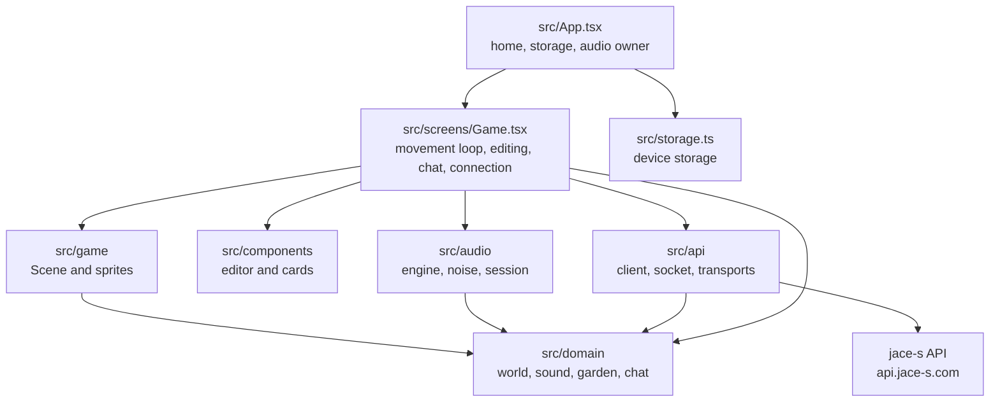

# Architecture Overview

Hush Garden is one Expo (React Native) codebase. The same screens build the web app, the Android app, the iPhone app and, by wrapping the web export, the Windows desktop app. Rules are plain TypeScript with no UI imports, so they are tested with Node.

Key points in text: `App` owns the audio engine and stored data and switches between the home screen and the game. `Game` runs the movement loop and connects everything. `domain` holds every rule and depends on nothing.

## Modules

| Module | Code | Role |
| --- | --- | --- |
| Rules | `src/domain/` | Geometry and movement, sound model, equalizer response, distance mixing, speaker editing and presets, characters and poses, speaker actions, name rules, chat range and cue, texts in three languages |
| Audio | `src/audio/` | Synthesis graph, noise generation, background playback session |
| Game view | `src/game/` | Quarter-view scene, joystick, markers, the ten animated characters, props and effects of actions, speaker, sound shadow and garden art |
| Screens and panels | `src/screens/`, `src/components/`, `src/ui.tsx` | Top bar, speaker editor with oscillator panels and the equalizer graph, consent, login, presets, settings; `src/i18n.tsx` gives screens the chosen language |
| Server access | `src/api/` | Account and garden HTTP client, garden socket, per-platform transport |
| Device data | `src/storage.ts`, `src/settings.ts`, `src/location.ts`, `src/coordinates.ts` | Private garden, settings, device location |
| Desktop wrapper | `src-tauri/` | Tauri window around the web export |

Design: [Garden Design](../design/app/10-garden.md).

## Two Gardens

- Private garden: everything runs on the device. No network call is made.
- Public garden: the server owns the speaker layout, presence and chat. The client sends its position and chat text and draws what the server reports. Sound is always synthesised on the device from the speaker settings.

## Platforms

| Target | Build | Notes |
| --- | --- | --- |
| Web | `npm run export:web` → `dist/`, deployed by Vercel from `main` | Sign-in with password or Google |
| Android | `npm run build:android` (Expo prebuild and Gradle) | Background playback through a media foreground service |
| Windows | `npm run desktop:build` (Tauri, needs Rust) | Wraps `dist/`; account requests go through the Tauri HTTP plugin |
| iPhone | configured in `app.config.js` | Not built yet |

## Server

The server side is part of the jace-s platform API (`services/api` in the jace-s-platform repository): entry with location consent, speaker storage and permission, the garden socket and the chat log. This repository holds no server code.

## Example Scenario

- Input: A player walks toward a speaker in the public garden while another player chats nearby.
- Steps: `Game` steps the position each frame → `GardenAudio.setListener()` updates gains → `GardenSocket.move()` reports the position → a `chat` message arrives → `cueFor()` computes depth and side → `GardenAudio.cue()` darkens the tone briefly and the bubble is drawn.
- Result: The noise grows louder on approach and its tone shifts for a moment when the other player speaks.

## Account Authentication
- The existing account client and platform-specific transports remain the session owners. Android adds native Google account selection and the platform native credential exchange; web keeps GIS. See [Account Login](../design/app/20-account-login.md).
