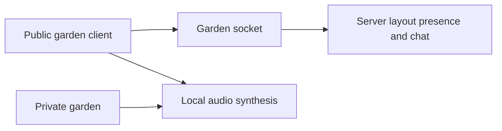

# Data Flow

The private garden processes position and audio on the device. In the public garden the server owns layout, presence and nearby chat. The client sends position and chat updates over the public garden socket, renders server state and synthesizes sound locally.

See [Architecture Overview](10-overview.md).
