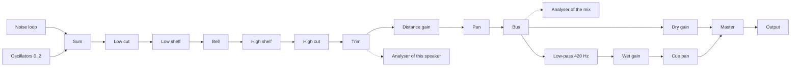
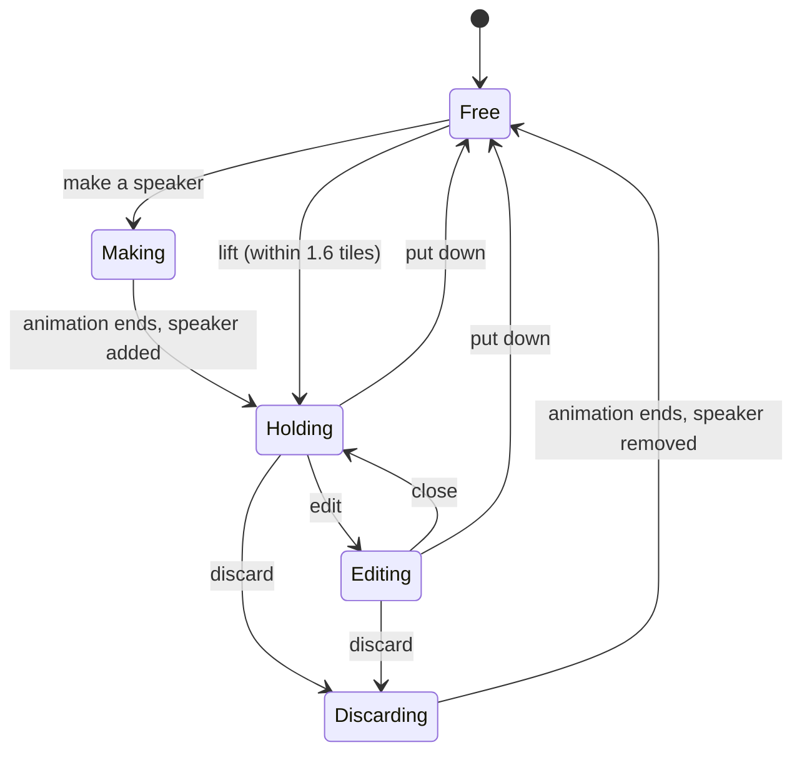

# Garden Design

- Spec: [Garden](../../specs/app/10-garden.md)
- Architecture: [Overview](../../architecture/10-overview.md)
- All scenarios: [Garden Scenarios](../../testing/scenarios/app/10-garden.md#garden-scenarios)

## Movement

- Input: pressed keys or a joystick offset, and the frame time.
- Output: the next position in tiles, inside the garden.
- Code: `src/domain/world.ts` → `step()`, `keysToInput()`, `joystickToInput()`, `toScreen()`, `toGarden()`; loop in `src/screens/Game.tsx`; joystick in `src/game/Scene.tsx`.
- Steps: the input is a screen direction → `toGarden()` turns it into a garden direction → it is normalised so every screen direction walks at 3.2 tiles per second → the position is clamped 0.35 tiles inside the edge.
- The joystick has a 15% dead zone; a half-pushed stick walks slower.
- Scenario: Up is held at (10, 10) for 0.1 s → the character moves straight up the screen, garden x and y both decrease.

## Distance Mixing

- Input: listener position and the speaker list.
- Output: a gain and a left/right balance per speaker.
- Code: `src/domain/sound.ts` → `reachOf()`, `gainAt()`, `loudnessAt()`, `panFor()`, `mixFor()`, `audibleCount()`, `REACH`.
- Steps: the reach is `2 + 9 × volume` tiles → gain is `(1 - d / reach)²` times the speaker volume, zero at or beyond the reach → balance follows the on-screen x difference, limited to ±0.8 → when the root of the summed squared gains exceeds 1, all gains are divided by it.
- Scenario: Three full-volume speakers on the same tile as the listener → each gain becomes about 0.58, so the total power equals one speaker.

## Sound Model

- Input: any stored or received value.
- Output: a valid `SpeakerSound`: `{volume, noise: {color, level}, oscillators: [{wave, frequency, level}], eq}`.
- Code: `src/domain/sound.ts` → `normalizeSound()`, `defaultSound()`, `defaultOscillator()`, `LIMITS`, `MAX_OSCILLATORS`, `WAVES`, `NOISE_COLORS`.
- Missing fields get defaults; numbers are clamped; at most two oscillators. The equalizer part is described in [Equalizer](#equalizer). The server enforces the same limits.
- The default sound is brown noise with oscillator A as a 55 Hz sine at level 0.55. A value that says nothing about oscillators gets that oscillator; an explicit empty list stays empty.
- Sounds stored before the bass drone was removed carry `bass: {frequency, level}`. It is read as a sine oscillator at `level × 0.5 / 0.3` (the drone played at half its level, an oscillator plays at 0.3 of its level), placed before the stored oscillators, and the list is cut to two. A stored `radius` is ignored.
- Scenario: `{volume: 9, noise: {color: "purple"}}` → volume 1, brown noise. `{bass: {frequency: 60, level: 0.3}, oscillators: [square 300 Hz]}` → oscillators sine 60 Hz at level 0.5, then the square.

## Audio Engine

- Input: speakers, listener position, master volume, chat cues.
- Output: sound through Web Audio in the browser and react-native-audio-api in the apps, with the same code.
- Code: `src/audio/engine.ts` → `GardenAudio` (`start()`, `pause()`, `setSpeakers()`, `setListener()`, `setVolume()`, `cue()`); `src/audio/noise.ts` → `fillNoise()`.

- Each speaker in range is a voice: sources into a filter chain, then distance gain and pan, into a shared bus.
- A voice exists only while the listener is within the speaker reach plus 1.5 tiles. It starts silent and glides in.
- Changing a value retunes the existing nodes with a short glide, so dragging a slider does not click. Nodes are rebuilt only when the noise colour or the oscillator waves change.
- Noise is a 6 second mono loop per colour, generated once. Pink uses Paul Kellet's filter. Brown is an integrator with its drift removed so the loop point matches.
- Boosted EQ bands are compensated by the trim gain, so a speaker cannot exceed its volume.
- The chat cue in tone mode fades the dry gain down by the cue depth and the dark copy up, panned toward the talker; in dip mode it lowers the master gain. Both use 0.05 s fades and a 0.22 s hold.
- Scenario: The listener walks from 10 to 7 tiles from a speaker at volume 0.7 (reach 8.3) → the voice is built at 9.8 tiles, silent until 8.3, then glides up.

## Chat Cue

- Input: listener and talker positions.
- Output: `{depth, pan}` or null beyond 10 tiles.
- Code: `src/domain/chat.ts` → `cueFor()`, `cleanMessage()`, `CUE_TIMING`.
- Depth is 0.25 at the edge of the range up to 0.85 next to the talker.
- Scenario: A talker 1 tile to the right → depth about 0.79, positive pan.

## Scene

- Input: player position, other characters, speakers, the held speaker, markers.
- Output: the drawn garden and the joystick callback.
- Code: `src/game/Scene.tsx` → `Scene`, `Actor`, `Marker`; `src/game/sprites.tsx` → `Ground`, `SpeakerArt`, `SoundShadow`, `Tree`; characters in [Characters](#characters).
- The ground is one SVG drawn once. Sprites are positioned views sorted by `x + y`. The camera moves one container.
- Markers are pressable things placed at a garden position with a screen offset: the lift button beside a speaker and the put down and edit buttons beside the character. They sit above everything and take the press before the joystick does.
- All art is drawn in code with react-native-svg; `scripts/make-icon.mjs` draws the app icon.

## Sound Shadows

- Input: a speaker's sound.
- Output: concentric sound waves on the ground under the trees, speakers and characters.
- Code: `src/game/sprites.tsx` → `SoundShadow`, `shadowSize()`, `shadowStrength()`, `SHADOW_TINT`; placed in `src/game/Scene.tsx`.
- Three rings in the noise colour (brown `#8a5326`, pink `#ff4f98`, white `#ffffff`) grow from the speaker to the reach seen in quarter view (`reach × 72 × √2` wide and half that high) in 2.7 s each, a third of a cycle apart, and fade out as they grow. A faint ellipse fills the reach. `shadowStrength()` sets the ring brightness from the volume. The rings are `Animated` views, so they run on the native driver in the apps.
- The centre opacity is `0.14 + 0.5 × volume`, and zero for a silent speaker. Outward the opacity falls to 62%, 32%, 10% and 0% of the centre at each quarter of the reach.
- Shadows are drawn with ordinary transparency, so overlapping shadows blend their colours.
- The scene draws the shadow from the same list the audio engine gets, in which a held speaker sits at the character's position.
- Scenario: A pink speaker at volume 1 next to a brown one at volume 0.4 → a wide, strong pink shadow of 11 tiles and a small faint brown one of 5.6 tiles; where they overlap the ground looks brownish pink.

## Private Garden And Presets

- Input: edit actions.
- Output: the new garden, saved on the device.
- Speakers change through [Handling Speakers](#handling-speakers).
- Code: `src/domain/garden.ts` → `addSpeaker()`, `moveSpeaker()`, `updateSpeaker()`, `removeSpeaker()`, `savePreset()`, `applyPreset()`, `deletePreset()`, `resetGarden()`, `normalizeMyGarden()`, `BUILT_IN_PRESETS`; `src/storage.ts`; `src/settings.ts`.
- AsyncStorage keys `hush-garden.my-garden.v1` and `hush-garden.settings.v1`. Broken stored data falls back to the initial garden or default settings.
- Scenario: Save "Night", apply "White Rain", apply "Night" → the saved layout returns.

## Public Garden Connection

- Input: consent, optional coordinates, the account session.
- Output: a live connection with other players, speakers and chat.
- Code: `src/api/client.ts` → `HushClient.enter()`, `saveSpeaker()`, `deleteSpeaker()`; `src/api/socket.ts` → `GardenSocket`, `parseServerMessage()`, `socketUrl()`; `src/location.ts` → `requestCoordinates()`; `src/coordinates.ts` → `roundCoordinate()`; flow in `src/screens/Game.tsx`.
- Steps: consent card → device location with an 8 s limit, rounded to two decimals, or none → `POST /hush-garden/enter` → WebSocket with the returned ticket → `hello` gives the start position, players and speakers.
- A lost connection is retried every 3 seconds with a new ticket. Login and logout also re-enter, because the ticket carries the identity.
- Positions are sent at most every 100 ms. Other characters glide to their reported positions.
- An editor's speaker change is shown at once and sent 400 ms after the last change. A made speaker is saved when it appears in the hands, a put down speaker when it is put down, and a discarded one is deleted when its animation ends.
- Every socket message is validated; unknown shapes are dropped.
- Server contract: the Hush Garden API documents in the jace-s platform repository (`docs/api/apps/hush-garden/`).
- The entry request also carries the chosen character and the typed name; the result has the name the server accepted. A name change while connected is a `rename` socket message; the server answers with `rename` to everyone or with an error.
- Scenario: A guest agrees, the device refuses location → the server names the place from the internet address and the guest enters.

## Account Transport

- Code: `src/api/transport.web.ts` (browser cookie and CSRF token from responses; in the desktop app requests go through the Tauri HTTP plugin), `src/api/transport.ts` (apps: session kept in encrypted storage and sent explicitly).
- The browser build signs in with a password or Google; the apps with a password.

## Background Playback

- Code: `src/audio/session.ts` → `configureSession()`, `showPlayback()`, `hidePlayback()`, `onPlaybackButtons()`; plugin options in `app.config.js`.
- iOS uses the playback audio session and the background audio mode. Android shows the media notification, which runs the media playback foreground service.
- While backgrounded, drawing stops and the character stays put; sound and chat cues continue.

## Desktop Wrapper

- Code: `src-tauri/` (Tauri 2, NSIS installer), `isDesktopApp()` in `src/api/transport.web.ts`.
- The window loads the bundled web export, so the private garden works offline. HTTP is limited to the API origin in `src-tauri/capabilities/default.json`.

## Equalizer

- Input: a stored or edited equalizer; drag positions on the graph; analyser data.
- Output: a valid `Equalizer`, the response curve, and the drawn graph.
- Code: `src/domain/equalizer.ts` → `normalizeEqualizer()`, `equalizerResponse()`, `moveBand()`, `handleOf()`, `hzToX()`, `xToHz()`, `dbToY()`, `yToDb()`, `graphFrequencies()`, `peakBoost()`, `EQ_LIMITS`; `src/components/EqGraph.tsx` → `EqGraph`; `src/audio/engine.ts` → `GardenAudio.spectrum()`, `tune()`.
- The model is `{bands: [{type, frequency, gain, q}] × 3}` with `type` one of `bell`, `lowcut`, `lowshelf`, `highshelf`, `highcut`; frequency 20 Hz to 20 kHz, gain -24 to +12 dB, Q 0.3 to 8. Older formats are still read: the five-band format becomes low shelf (or the low cut when it was set and the shelf was flat), bell, high shelf (or the high cut likewise); the first format (`eq.low`, `eq.mid`, `eq.high` plus a separate `filter`) the same way.
- `bandCoefficients()` computes each point's second-order filter with the Audio EQ Cookbook formulas, using its Q for every kind. The curve is the sum in dB of the three at 96 frequencies spread by octave, and the audio engine plays the same coefficients through `IIRFilterNode`s, so the curve and the sound match. Web Audio shelves have no Q, which is why biquad nodes are not used.
- An IIR filter cannot glide, so a changed point builds a new filter beside the old one and crossfades in about 20 ms; swaps of one point are at most every 30 ms while dragging.
- The graph maps 20 Hz to 20 kHz across its width by logarithm and +18 dB to -30 dB down its height. A press picks the nearest handle within 36 px; dragging calls `moveBand()`, which clamps every value. The kind chips call `setBandType()` and the Q knob `updateBand()`.
- The analyser is read every 80 ms. `spectrum(speakerId)` attaches an analyser after that speaker's trim gain on first use; when the speaker has no voice (out of range) it uses an analyser on the bus. Levels from -100 dB to -10 dB fill the graph height.
- The trim gain divides by the highest point of the curve (`peakBoost()`), so boosting a band, or the bump of a narrow shelf or resonant cut, reshapes the sound without raising its peak level.
- Scenario: Low shelf +9 dB at 200 Hz, bell -12 dB at 1 kHz with Q 2, high shelf +6 dB at 4 kHz → the curve reads about +9 dB at 40 Hz, +4.5 dB at 200 Hz, -12 dB at 1 kHz and +6 dB at 12 kHz.

## Characters

- Input: the chosen character, whether it walks, the walking frame, whether it carries, and a stance during an action.
- Output: one drawn character in a pose.
- Code: `src/domain/characters.ts` → `CHARACTER_KINDS`, `normalizeCharacter()`, `poseFor()`, `nextWalkFrame()`, `WALK_FRAMES`, `WALK_FRAME_MS`, `STANDING`; `src/game/characters.tsx` → `Character`, `CharacterArt`; picker in `src/App.tsx`.
- All ten characters are built from the same parts (feet, arms, body, belly, ears, face), each with its own colours, ear shape and face. One pose therefore animates every character.
- The walking cycle has four pictures shown 130 ms each: left step (left foot lifted, body up, arms and ears swung), passing pose, right step, passing pose. `Character` runs its own timer while `walking` is true, so characters step out of sync.
- The player's own `walking` and `facing` come from the input; other players' come from their reported movement in `src/screens/Game.tsx` (walking while gliding to a new position, facing by the on-screen x direction).
- During an action `Character` gets a `stance`: the whole body is lifted, shifted, leaned and squashed around its feet with a view transform while its ground shadow stays put, and `turn` shows it turned around.
- Scenario: A player holds Right for one second → about eight pictures are shown, alternating left and right steps; on release the standing pose returns.

## Handling Speakers

- Input: the lift, put down, edit, make and discard buttons; the character and speaker positions.
- Output: the speaker list, the held speaker and the action being played.
- Code: `src/screens/Game.tsx` → `lift()`, `putDown()`, `create()`, `discard()`, `play()`, `liftable`, `markers`; `src/domain/characters.ts` → `PICK_UP_TILES`, `poseFor(…, carrying)`; `src/game/Scene.tsx` → `carriedId`, `markers`.

- Key points in text: the hands are free or hold one speaker. Making ends in holding; discarding starts from holding. Editing is possible only while holding.
- `liftable` is the nearest stored speaker within 1.6 tiles while the hands are free and no action plays; its lift button is a marker beside it.
- `play(name, colour, after)` sets the action, blocks walking through `acting`, and after `actionDuration()` clears it and runs `after`. Making adds the speaker at the character's position and holds it; discarding removes it (and calls `deleteSpeaker` in the public garden).
- The held speaker stays in the stored list at its old position; the list given to the scene and the audio engine has it at the character's position. Edits always start from the stored list, so a temporary position is never saved.
- `lift` and `putDown` carry a `GroundSpot`: where the speaker stands, worked out by `groundSpotFor()` in the scene, so the first frame of a lift and the last of a put down sit on the drawn speaker. The held speaker is drawn at scale 1 (`CARRY`). The frames ease in and out and start and end in the neutral pose. The name label rises with the speaker.
- Put down plays the `putDown` action, which is `lift` played backwards (`actionAt()` reads `lift` at `duration - t`), and when it ends stores the character position plus one step toward the facing side, clamped to the garden.
- When the held speaker disappears from the stored list (another editor removed it), the hands become free.
- Scenario: The character stands next to a speaker → lift → walk 4 tiles right → edit, raise the volume, close → put down → the speaker stands one step in front of the character with the new volume, and only now has its stored position changed.

## Speaker Actions

- Input: the character kind, the action name and the time since it started.
- Output: the body stance, the prop (what is in the hands, where, how big, how turned, how visible), arms up or down, facing, and the effects to draw.
- Code: `src/domain/actions.ts` → `actionAt()`, `actionDuration()`, `actionFrames()`, `Keyframe`, `Stance`, `PropState`, `CARRY`, `NEUTRAL`, `FX_MS`; `src/game/Scene.tsx` → `ActorBody`; `src/game/props.tsx` → `PropView`, `FxView`.
- An action is a list of keyframes. Numbers (hop, shift, lean, squash, arm angles, prop position, scale, spin, opacity) glide from one keyframe to the next, optionally easing in or out; arms, prop form (speaker, egg, yarn, leaf), turn and whether the prop rides the body switch at a keyframe. A keyframe can start one-shot effects (puff, dirt, sparkle, crumbs, crack, leaves) shown for 420 ms.
- Distances are screen pixels from the character's feet; x is the facing direction and y is up. The scene mirrors them when the character faces left.
- Every making action ends with the prop at `CARRY` (overhead, arms up) and a neutral body; every discarding action starts there and ends with the prop invisible. Lifting is one shared action of 300 ms.
- `ActorBody` redraws every 33 ms while an action plays.

| Character | Making | Discarding |
| --- | --- | --- |
| Bunny | Pulls it out of the ground like a carrot | Kicks it away |
| Cat | Pounces on a ball of yarn that turns into it | Nudges it to the edge and swipes it off |
| Bear | Claps twice and catches it as it falls from the sky | Hugs it until it pops |
| Frog | Leaps out of sight and lands holding it | Swallows it |
| Chick | Lays an egg that hatches into it | Pecks it to crumbs |
| Fox | Spins in smoke; a leaf floats down and becomes it | Tosses it up and turns it into a leaf |
| Penguin | Slides away on its belly and pushes it back | Slaps it away over the ice |
| Pig | Digs it up with its snout | Jumps up and sits it flat |
| Panda | Somersaults and comes up with it | Rolls it away like a ball |
| Mouse | Pumps a crumb-sized one up to full size | Nibbles it away |

- Adding a character needs a making and a discarding list in `CREATE` and `DISCARD`.
- Scenario: The chick makes a speaker → at 0.6 s an egg sits behind it, at 0.9 s the chick has turned to watch the egg wobble, at 1.1 s the egg has become a small speaker, at 1.7 s the speaker is overhead.

## Speaker Editor

- Input: the held speaker and drags on its controls.
- Output: the edited speaker.
- Code: `src/components/SpeakerEditor.tsx` → `SpeakerEditor`, `OscillatorPanel`; `src/ui.tsx` → `Knob`, `Slider`, `Tabs`, `DragLockContext`, `NO_TOUCH_SCROLL`; `src/game/sprites.tsx` → `WavePicture`; `src/domain/sound.ts` → `waveShape()`.
- `Prepared` (`src/ui.tsx`) lays its children out invisibly (`HIDDEN_READY`) and reveals them three frames after its first layout, when measured children have applied their sizes; with `hidden` it stays invisible but mounted. `Modal` uses it, the settings modal is always mounted with `hidden` while closed, and its card is memoised so walking does not redraw it. The speaker editor keeps the inactive tabs absolutely placed and hidden; the equalizer reads the spectrum only while its tab is shown.
- Three tabs: Sound (volume with the reach it gives, noise colour and level), Oscillators (OSC A and OSC B panels, an add button while fewer than two), Equalizer ([Equalizer](#equalizer)).
- An oscillator panel has a dark display with two cycles of the wave, drawn taller as the level rises; four wave buttons that show the wave as a picture; and a frequency knob (logarithmic) and a level knob.
- A knob turns by `(right − up) / 170 px` of drag, so vertical and horizontal drags both work.
- Dragged controls call the drag lock while a finger is down; the editor's scroll view stops scrolling meanwhile. On the web they also set `touch-action: none` so the browser does not scroll with the same touch.
- The editor is a side panel on screens at least 820 px wide and a bottom sheet of 56% of the height otherwise.
- Scenario: On a phone the player drags the OSC A level knob up by 50 px → the level rises by about 0.29, the wave in the display grows, and the list does not scroll.

## Top Bar And Settings

- Code: `src/screens/Game.tsx` (top bar), `src/components/Panels.tsx` → `SettingsCard`; `src/ui.tsx` → `IconBtn`, `GearIcon`.
- The top bar is one row: the make or discard button on the left for players who may edit, the status pill in the centre (garden, visitors when online, speakers heard), the gear button on the right. Notices appear centred under it.
- The settings card holds sound on and off, master volume, language, character name, chat cue, account (public garden), presets (private garden) and leaving the garden.
- Scenario: A guest in the public garden → no speaker button on the left; the centre shows the garden, the visitor count and the speakers heard; the gear opens settings with a login button.

## Languages

- Input: a text key, the chosen language and values for the `{name}` parts.
- Output: the text to show.
- Code: `src/domain/text.ts` → `TEXTS`, `translate()`, `LANGUAGES`, `LANGUAGE_NAMES`, `normalizeLanguage()`, `languageForLocale()`; `src/i18n.tsx` → `LanguageProvider`, `useT()`, `useLanguage()`; `src/settings.ts` → `Settings.language`, `deviceLanguage()`.
- Every text has a key and an entry in Korean, English and Japanese. Screens call `useT()` and ask by key. Errors and notices are kept as keys and translated when drawn, so they follow a language change.
- A stored language is kept; without one the device language is used when the app has it, otherwise English.
- Scenario: A device set to Japanese opens the app for the first time → Japanese; the player picks English in settings → every screen switches at once and stays English on the next start.

## Names

- Input: a typed name.
- Output: a cleaned name or a reason for refusal.
- Code: `src/domain/names.ts` → `checkName()`, `isReservedName()`, `simplifyName()`, `NAME_MAX_LENGTH`; settings card in `src/components/Panels.tsx`; `changeName()` in `src/screens/Game.tsx`; `src/settings.ts` (a stored name that no longer passes is dropped).
- Steps: control characters removed, spaces collapsed, trimmed → empty or over 16 characters is refused → the name is simplified (NFKC, lower case, look-alike digits and symbols replaced, everything but letters and digits removed) → refused if the result contains a reserved part or equals a reserved whole word.
- Reserved parts match anywhere ("admin", "moderator", "관리자", …). Short words ("gm", "mod", "dev", "bot", …) are refused only as the whole name, so "Modest" and "Devon" pass.
- The server repeats the check and decides; its refusal is shown under the name field.
- Scenario: "ADM1N" → simplified to "admin" → refused. "Gmail fan" → "gmailfan" → accepted.

## Desktop Chat Focus
- Input: Chat becomes available on a web device whose primary pointer is fine and supports hover, or the player sends a message.
- Output: The chat text field receives focus; Enter submits without blurring. Touch-primary web and native mobile keep their existing focus behavior.
- Code: `src/screens/Game.tsx` passes the chat ref, desktop autoFocus and submit behavior to `Input`; sendChat restores desktop focus. `src/ui.tsx` forwards optional inputRef, autoFocus and submitBehavior only to TextInput.
- Scenario: Input a signed-in desktop player with chat available; steps type a message and press Enter or Send; result the draft clears and typing can continue in the same field. On a phone, entering the garden does not automatically open the keyboard.

## Account Character Name Restore
- Input: Authenticated enter response with characterName. Output: settings.name replaced by the server nickname, including empty fallback. Code: src/api/types.ts Entry and src/screens/Game.tsx entry handling. NAME_SAVE_FAILED is displayed for failed socket saves.
- Scenario: Input another device with stale name; steps enter the public garden after login; expected result settings and displayed name follow the account profile. Private offline use remains device-local.
