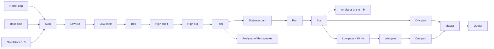

# Garden Design

- Spec: [Garden](../../specs/app/10-garden.md)
- Architecture: [Overview](../../architecture/10-overview.md)
- All scenarios: [Garden Scenarios](../../testing/scenarios/app/10-garden.md#garden-scenarios)

## Movement

- Input: pressed keys or a joystick offset, and the frame time.
- Output: the next position in tiles, inside the garden.
- Code: `src/domain/world.ts` → `step()`, `keysToInput()`, `joystickToInput()`, `toScreen()`, `toGarden()`; loop in `src/screens/Game.tsx`; joystick in `src/game/Scene.tsx`.
- Steps: the input is a screen direction → `toGarden()` turns it into a garden direction → it is normalised so every screen direction walks at 3.2 tiles per second → the position is clamped 0.35 tiles inside the edge.
- The joystick has a 15% dead zone; a half-pushed stick walks slower. A touch that moves less than 8 px and lasts under 350 ms is a tap, used by the editor.
- Scenario: Up is held at (10, 10) for 0.1 s → the character moves straight up the screen, garden x and y both decrease.

## Distance Mixing

- Input: listener position and the speaker list.
- Output: a gain and a left/right balance per speaker.
- Code: `src/domain/sound.ts` → `gainAt()`, `panFor()`, `mixFor()`.
- Steps: gain is `(1 - d / radius)²` times the speaker volume, zero at or beyond the radius → balance follows the on-screen x difference, limited to ±0.8 → when the root of the summed squared gains exceeds 1, all gains are divided by it.
- Scenario: Three full-volume speakers on the same tile as the listener → each gain becomes about 0.58, so the total power equals one speaker.

## Sound Model

- Input: any stored or received value.
- Output: a valid `SpeakerSound`.
- Code: `src/domain/sound.ts` → `normalizeSound()`, `defaultSound()`, `LIMITS`.
- Missing fields get defaults; numbers are clamped; at most three oscillators. The equalizer part is described in [Equalizer](#equalizer). The server enforces the same limits.
- Scenario: `{volume: 9, noise: {color: "purple"}}` → volume 1, brown noise.

## Audio Engine

- Input: speakers, listener position, master volume, chat cues.
- Output: sound through Web Audio in the browser and react-native-audio-api in the apps, with the same code.
- Code: `src/audio/engine.ts` → `GardenAudio` (`start()`, `pause()`, `setSpeakers()`, `setListener()`, `setVolume()`, `cue()`); `src/audio/noise.ts` → `fillNoise()`.

- Each speaker in range is a voice: sources into a filter chain, then distance gain and pan, into a shared bus.
- A voice exists only while the listener is within the speaker radius plus 1.5 tiles. It starts silent and glides in.
- Changing a value retunes the existing nodes with a short glide, so dragging a slider does not click. Nodes are rebuilt only when the noise colour or the oscillator waves change.
- Noise is a 6 second mono loop per colour, generated once. Pink uses Paul Kellet's filter. Brown is an integrator with its drift removed so the loop point matches.
- Boosted EQ bands are compensated by the trim gain, so a speaker cannot exceed its volume.
- The chat cue in tone mode fades the dry gain down by the cue depth and the dark copy up, panned toward the talker; in dip mode it lowers the master gain. Both use 0.05 s fades and a 0.22 s hold.
- Scenario: The listener walks from 9 to 7 tiles from a speaker with radius 8 → the voice is built at 9.5 tiles, silent until 8, then glides up.

## Chat Cue

- Input: listener and talker positions.
- Output: `{depth, pan}` or null beyond 10 tiles.
- Code: `src/domain/chat.ts` → `cueFor()`, `cleanMessage()`, `CUE_TIMING`.
- Depth is 0.25 at the edge of the range up to 0.85 next to the talker.
- Scenario: A talker 1 tile to the right → depth about 0.79, positive pan.

## Scene

- Input: player position, other characters, speakers, edit state.
- Output: the drawn garden and input callbacks.
- Code: `src/game/Scene.tsx` → `Scene`; `src/game/sprites.tsx` → `Ground`, `SpeakerArt`, `Tree`; characters in [Characters](#characters).
- The ground is one SVG drawn once. Sprites are positioned views sorted by `x + y`. The camera moves one container.
- A tap inside a speaker picture selects that speaker even though its ground point is at its feet.
- All art is drawn in code with react-native-svg; `scripts/make-icon.mjs` draws the app icon.

## Private Garden And Presets

- Input: edit actions.
- Output: the new garden, saved on the device.
- Moving a speaker goes through [Carrying](#carrying).
- Code: `src/domain/garden.ts` → `addSpeaker()`, `moveSpeaker()`, `updateSpeaker()`, `removeSpeaker()`, `savePreset()`, `applyPreset()`, `deletePreset()`, `resetGarden()`, `normalizeMyGarden()`, `BUILT_IN_PRESETS`; `src/storage.ts`; `src/settings.ts`.
- AsyncStorage keys `hush-garden.my-garden.v1` and `hush-garden.settings.v1`. Broken stored data falls back to the initial garden or default settings.
- Scenario: Save "Night", apply "White Rain", apply "Night" → the saved layout returns.

## Public Garden Connection

- Input: consent, optional coordinates, the account session.
- Output: a live connection with other players, speakers and chat.
- Code: `src/api/client.ts` → `HushClient.enter()`, `saveSpeaker()`, `deleteSpeaker()`; `src/api/socket.ts` → `GardenSocket`, `parseServerMessage()`, `socketUrl()`; `src/location.ts` → `requestCoordinates()`; `src/coordinates.ts` → `roundCoordinate()`; flow in `src/screens/Game.tsx`.
- Steps: consent card → device location with an 8 s limit, rounded to two decimals, or none → `POST /hush-garden/enter` → WebSocket with the returned ticket → `hello` gives the start position, players and speakers.
- A lost connection is retried every 3 seconds with a new ticket. Login and logout also re-enter, because the ticket carries the identity.
- Positions are sent at most every 100 ms. Other characters glide to their reported positions.
- An editor's speaker change is shown at once and sent 400 ms after the last change.
- Every socket message is validated; unknown shapes are dropped.
- Server contract: the Hush Garden API documents in the jace-s platform repository (`docs/api/apps/hush-garden/`).
- The entry request also carries the chosen character and the typed name; the result has the name the server accepted. A name change while connected is a `rename` socket message; the server answers with `rename` to everyone or with an error.
- Scenario: A guest agrees, the device refuses location → the server names the place from the internet address and the guest enters.

## Account Transport

- Code: `src/api/transport.web.ts` (browser cookie and CSRF token from responses; in the desktop app requests go through the Tauri HTTP plugin), `src/api/transport.ts` (apps: session kept in encrypted storage and sent explicitly).
- The browser build signs in with a password or Google; the apps with a password.

## Background Playback

- Code: `src/audio/session.ts` → `configureSession()`, `showPlayback()`, `hidePlayback()`, `onPlaybackButtons()`; plugin options in `app.config.js`.
- iOS uses the playback audio session and the background audio mode. Android shows the media notification, which runs the media playback foreground service.
- While backgrounded, drawing stops and the character stays put; sound and chat cues continue.

## Desktop Wrapper

- Code: `src-tauri/` (Tauri 2, NSIS installer), `isDesktopApp()` in `src/api/transport.web.ts`.
- The window loads the bundled web export, so the private garden works offline. HTTP is limited to the API origin in `src-tauri/capabilities/default.json`.

## Equalizer

- Input: a stored or edited equalizer; drag positions on the graph; analyser data.
- Output: a valid `Equalizer`, the response curve, and the drawn graph.
- Code: `src/domain/equalizer.ts` → `normalizeEqualizer()`, `equalizerResponse()`, `moveBand()`, `handleOf()`, `hzToX()`, `xToHz()`, `dbToY()`, `yToDb()`, `graphFrequencies()`, `peakBoost()`, `EQ_LIMITS`; `src/components/EqGraph.tsx` → `EqGraph`; `src/audio/engine.ts` → `GardenAudio.spectrum()`, `tune()`.
- The model is `{highpass, lowShelf: {frequency, gain}, bell: {frequency, gain, q}, highShelf: {frequency, gain}, lowpass}`. The first format (`eq.low`, `eq.mid`, `eq.high` plus a separate `filter`) is still read and converted.
- The curve is the sum in dB of five second-order filters computed with the Audio EQ Cookbook formulas, the same ones the audio nodes use, at 96 frequencies spread by octave. The cuts use Q 0.707 and the shelves slope 1.
- The graph maps 20 Hz to 20 kHz across its width by logarithm and +18 dB to -30 dB down its height. A press picks the nearest handle within 30 px; dragging calls `moveBand()`, which clamps every value and keeps the high cut at or above the low cut.
- The analyser is read every 80 ms. `spectrum(speakerId)` attaches an analyser after that speaker's trim gain on first use; when the speaker has no voice (out of range) it uses an analyser on the bus. Levels from -100 dB to -10 dB fill the graph height.
- The trim gain divides by the largest boost (`peakBoost()`), so boosting a band reshapes the sound without raising its peak level.
- Scenario: Low shelf +9 dB at 200 Hz, bell -12 dB at 1 kHz with Q 2, high shelf +6 dB at 4 kHz → the curve reads about +9 dB at 40 Hz, +4.5 dB at 200 Hz, -12 dB at 1 kHz and +6 dB at 12 kHz.

## Characters

- Input: the chosen character, whether it walks, the walking frame, whether it carries.
- Output: one drawn character in a pose.
- Code: `src/domain/characters.ts` → `CHARACTER_KINDS`, `normalizeCharacter()`, `poseFor()`, `nextWalkFrame()`, `WALK_FRAMES`, `WALK_FRAME_MS`, `STANDING`; `src/game/characters.tsx` → `Character`, `CharacterArt`; picker in `src/App.tsx`.
- All ten characters are built from the same parts (feet, arms, body, belly, ears, face), each with its own colours, ear shape and face. One pose therefore animates every character.
- The walking cycle has four pictures shown 130 ms each: left step (left foot lifted, body up, arms and ears swung), passing pose, right step, passing pose. `Character` runs its own timer while `walking` is true, so characters step out of sync.
- The player's own `walking` and `facing` come from the input; other players' come from their reported movement in `src/screens/Game.tsx` (walking while gliding to a new position, facing by the on-screen x direction).
- Scenario: A player holds Right for one second → about eight pictures are shown, alternating left and right steps; on release the standing pose returns.

## Carrying

- Input: the carry button, the character and speaker positions.
- Output: the speaker held overhead, then placed in front of the character.
- Code: `src/screens/Game.tsx` → `carrySelected()`, `putDown()`, the approach branch of the movement loop; `src/domain/characters.ts` → `PICK_UP_TILES`, `LIFT_FRAMES`, `liftProgress()`, `poseFor(…, carrying)`; `src/game/Scene.tsx` → `CarriedSpeaker`, `carriedId`.
- Steps: the button sets the speaker as the approach target → each frame the loop steers the character toward it on screen → within 1.3 tiles the speaker becomes carried → the scene stops drawing it on the ground and draws it above the character, rising over four pictures of 70 ms → the speaker list handed to the audio engine and the range ring uses the character position for the carried speaker → the button puts it down at the character position plus one step toward the facing side, clamped to the garden.
- Keyboard or joystick input during the approach cancels it. Closing the editor, leaving edit mode or pressing the button again while carrying puts the speaker down. Deleting a carried speaker just removes it.
- In the public garden only the put-down position is sent to the server (`saveSpeaker`); others do not see the carrying itself.
- Scenario: The character stands 5 tiles from a selected speaker and the player presses carry → it walks over, lifts the speaker, the player walks 4 tiles right and presses put down → the speaker stands next to the character there.

## Names

- Input: a typed name.
- Output: a cleaned name or a reason for refusal.
- Code: `src/domain/names.ts` → `checkName()`, `isReservedName()`, `simplifyName()`, `NAME_MAX_LENGTH`; settings card in `src/components/Panels.tsx`; `changeName()` in `src/screens/Game.tsx`; `src/settings.ts` (a stored name that no longer passes is dropped).
- Steps: control characters removed, spaces collapsed, trimmed → empty or over 16 characters is refused → the name is simplified (NFKC, lower case, look-alike digits and symbols replaced, everything but letters and digits removed) → refused if the result contains a reserved part or equals a reserved whole word.
- Reserved parts match anywhere ("admin", "moderator", "관리자", …). Short words ("gm", "mod", "dev", "bot", …) are refused only as the whole name, so "Modest" and "Devon" pass.
- The server repeats the check and decides; its refusal is shown under the name field.
- Scenario: "ADM1N" → simplified to "admin" → refused. "Gmail fan" → "gmailfan" → accepted.

## Desktop Chat Focus
- Input: Chat becomes available on a web device whose primary pointer is fine and supports hover, or the player sends a message.
- Output: The chat text field receives focus; Enter submits without blurring. Touch-primary web and native mobile keep their existing focus behavior.
- Code: `src/screens/Game.tsx` passes the chat ref, desktop autoFocus and submit behavior to `Input`; sendChat restores desktop focus. `src/ui.tsx` forwards optional inputRef, autoFocus and submitBehavior only to TextInput.
- Scenario: Input a signed-in desktop player with chat available; steps type a message and press Enter or Send; result the draft clears and typing can continue in the same field. On a phone, entering the garden does not automatically open the keyboard.

## Account Character Name Restore
- Input: Authenticated enter response with characterName. Output: settings.name replaced by the server nickname, including empty fallback. Code: src/api/types.ts Entry and src/screens/Game.tsx entry handling. NAME_SAVE_FAILED is displayed for failed socket saves.
- Scenario: Input another device with stale name; steps enter the public garden after login; expected result settings and displayed name follow the account profile. Private offline use remains device-local.
