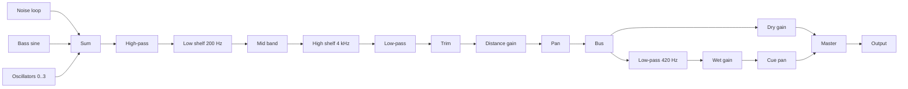

# Garden Design

- Spec: [Garden](../../specs/app/10-garden.md)
- Architecture: [Overview](../../architecture/10-overview.md)
- All scenarios: [Garden Scenarios](../../testing/scenarios/app/10-garden.md#garden-scenarios)

## Movement

- Input: pressed keys or a joystick offset, and the frame time.
- Output: the next position in tiles, inside the garden.
- Code: `src/domain/world.ts` → `step()`, `keysToInput()`, `joystickToInput()`, `toScreen()`, `toGarden()`; loop in `src/screens/Game.tsx`; joystick in `src/game/Scene.tsx`.
- Steps: the input is a screen direction → `toGarden()` turns it into a garden direction → it is normalised so every screen direction walks at 3.2 tiles per second → the position is clamped 0.35 tiles inside the edge.
- The joystick has a 15% dead zone; a half-pushed stick walks slower. A touch that moves less than 8 px and lasts under 350 ms is a tap, used by the editor.
- Scenario: Up is held at (10, 10) for 0.1 s → the character moves straight up the screen, garden x and y both decrease.

## Distance Mixing

- Input: listener position and the speaker list.
- Output: a gain and a left/right balance per speaker.
- Code: `src/domain/sound.ts` → `gainAt()`, `panFor()`, `mixFor()`.
- Steps: gain is `(1 - d / radius)²` times the speaker volume, zero at or beyond the radius → balance follows the on-screen x difference, limited to ±0.8 → when the root of the summed squared gains exceeds 1, all gains are divided by it.
- Scenario: Three full-volume speakers on the same tile as the listener → each gain becomes about 0.58, so the total power equals one speaker.

## Sound Model

- Input: any stored or received value.
- Output: a valid `SpeakerSound`.
- Code: `src/domain/sound.ts` → `normalizeSound()`, `defaultSound()`, `LIMITS`.
- Missing fields get defaults; numbers are clamped; at most three oscillators; the low-pass cutoff is never below the high-pass cutoff. The server enforces the same limits.
- Scenario: `{volume: 9, noise: {color: "purple"}}` → volume 1, brown noise.

## Audio Engine

- Input: speakers, listener position, master volume, chat cues.
- Output: sound through Web Audio in the browser and react-native-audio-api in the apps, with the same code.
- Code: `src/audio/engine.ts` → `GardenAudio` (`start()`, `pause()`, `setSpeakers()`, `setListener()`, `setVolume()`, `cue()`); `src/audio/noise.ts` → `fillNoise()`.

- Each speaker in range is a voice: sources into a filter chain, then distance gain and pan, into a shared bus.
- A voice exists only while the listener is within the speaker radius plus 1.5 tiles. It starts silent and glides in.
- Changing a value retunes the existing nodes with a short glide, so dragging a slider does not click. Nodes are rebuilt only when the noise colour or the oscillator waves change.
- Noise is a 6 second mono loop per colour, generated once. Pink uses Paul Kellet's filter. Brown is an integrator with its drift removed so the loop point matches.
- Boosted EQ bands are compensated by the trim gain, so a speaker cannot exceed its volume.
- The chat cue in tone mode fades the dry gain down by the cue depth and the dark copy up, panned toward the talker; in dip mode it lowers the master gain. Both use 0.05 s fades and a 0.22 s hold.
- Scenario: The listener walks from 9 to 7 tiles from a speaker with radius 8 → the voice is built at 9.5 tiles, silent until 8, then glides up.

## Chat Cue

- Input: listener and talker positions.
- Output: `{depth, pan}` or null beyond 10 tiles.
- Code: `src/domain/chat.ts` → `cueFor()`, `cleanMessage()`, `CUE_TIMING`.
- Depth is 0.25 at the edge of the range up to 0.85 next to the talker.
- Scenario: A talker 1 tile to the right → depth about 0.79, positive pan.

## Scene

- Input: player position, other characters, speakers, edit state.
- Output: the drawn garden and input callbacks.
- Code: `src/game/Scene.tsx` → `Scene`; `src/game/sprites.tsx` → `Ground`, `Character`, `SpeakerArt`, `Tree`.
- The ground is one SVG drawn once. Sprites are positioned views sorted by `x + y`. The camera moves one container.
- A tap inside a speaker picture selects that speaker even though its ground point is at its feet.
- All art is drawn in code with react-native-svg; `scripts/make-icon.mjs` draws the app icon.

## Private Garden And Presets

- Input: edit actions.
- Output: the new garden, saved on the device.
- Code: `src/domain/garden.ts` → `addSpeaker()`, `moveSpeaker()`, `updateSpeaker()`, `removeSpeaker()`, `savePreset()`, `applyPreset()`, `deletePreset()`, `resetGarden()`, `normalizeMyGarden()`, `BUILT_IN_PRESETS`; `src/storage.ts`; `src/settings.ts`.
- AsyncStorage keys `hush-garden.my-garden.v1` and `hush-garden.settings.v1`. Broken stored data falls back to the initial garden or default settings.
- Scenario: Save "Night", apply "White Rain", apply "Night" → the saved layout returns.

## Public Garden Connection

- Input: consent, optional coordinates, the account session.
- Output: a live connection with other players, speakers and chat.
- Code: `src/api/client.ts` → `HushClient.enter()`, `saveSpeaker()`, `deleteSpeaker()`; `src/api/socket.ts` → `GardenSocket`, `parseServerMessage()`, `socketUrl()`; `src/location.ts` → `requestCoordinates()`; `src/coordinates.ts` → `roundCoordinate()`; flow in `src/screens/Game.tsx`.
- Steps: consent card → device location with an 8 s limit, rounded to two decimals, or none → `POST /hush-garden/enter` → WebSocket with the returned ticket → `hello` gives the start position, players and speakers.
- A lost connection is retried every 3 seconds with a new ticket. Login and logout also re-enter, because the ticket carries the identity.
- Positions are sent at most every 100 ms. Other characters glide to their reported positions.
- An editor's speaker change is shown at once and sent 400 ms after the last change.
- Every socket message is validated; unknown shapes are dropped.
- Server contract: the Hush Garden API documents in the jace-s platform repository (`docs/api/apps/hush-garden/`).
- Scenario: A guest agrees, the device refuses location → the server names the place from the internet address and the guest enters.

## Account Transport

- Code: `src/api/transport.web.ts` (browser cookie and CSRF token from responses; in the desktop app requests go through the Tauri HTTP plugin), `src/api/transport.ts` (apps: session kept in encrypted storage and sent explicitly).
- The browser build signs in with a password or Google; the apps with a password.

## Background Playback

- Code: `src/audio/session.ts` → `configureSession()`, `showPlayback()`, `hidePlayback()`, `onPlaybackButtons()`; plugin options in `app.config.js`.
- iOS uses the playback audio session and the background audio mode. Android shows the media notification, which runs the media playback foreground service.
- While backgrounded, drawing stops and the character stays put; sound and chat cues continue.

## Desktop Wrapper

- Code: `src-tauri/` (Tauri 2, NSIS installer), `isDesktopApp()` in `src/api/transport.web.ts`.
- The window loads the bundled web export, so the private garden works offline. HTTP is limited to the API origin in `src-tauri/capabilities/default.json`.
