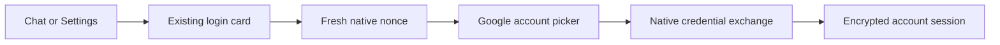

# Account Login Design
- Input: HushClient, the remember selection, server Google configuration and native account-picker credentials.
- Output: The existing User and encrypted session, or a cancelled attempt with no exchange and no account change.
- Code: src/components/GoogleButton.tsx, src/components/GoogleButton.web.tsx, src/components/nativeGoogleFlow.ts, src/components/Panels.tsx, src/api/client.ts and src/api/transport.ts.
- Reuse: The Android flow follows the existing companion implementation. Each product remains independently buildable; no cross-repository runtime imports are added.
- Spec: [Account Login](../../specs/app/20-account-login.md).
- Architecture: [Overview](../../architecture/10-overview.md).
- Scenarios: [Account Login](../../testing/scenarios/app/20-account-login.md).

## Native Button
GoogleButton uses the official 44px high button in the current login card, above the password fields. The accessibility label and safe errors follow the chosen language. Its working ref blocks duplicate presses and mounted state ignores dismissed-card results. Android uses the native module; Metro resolves GoogleButton.web.tsx for the existing browser implementation. iOS retains password login.

## Native Contracts
NativeGoogleClient defines googleConfig, nativeGoogleChallenge and nativeGoogleLogin. NativeGoogleProvider defines Play Services checking, configuration and explicit account selection. signInWithNativeGoogle checks liveness between asynchronous steps, uses the runtime web Client ID and a fresh server nonce, disables automatic account selection and exchanges only a selected credential.
HushClient.nativeGoogleChallenge calls POST /auth/google/native/challenge. HushClient.nativeGoogleLogin clears old local credentials, posts credential, nonce, remember and timeZone to /auth/google/native, and requires the existing native transport to save credentials before publishing currentUser. The transport retains the existing encrypted session and CSRF handling; no Google token is persisted.

## Example
- Input: Picker cancellation followed by retry.
- Steps: Request nonce A, cancel, request nonce B and choose an account.
- Expected result: No exchange for A; B creates the usual session and the garden reconnects under the account.

- Native dependencies are pinned to react-native-nitro-google-signin 2.3.1 and react-native-nitro-modules 0.37.2, matching the existing companion implementation.
