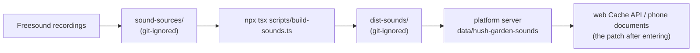

# Nature Sounds

How the nature recordings get from Freesound to the devices. The source recordings and the built files are not in git: the sources stay in `sound-sources/` on the developer's machine and the built files are handed out by the platform server.

Key points in text: recordings are chosen and listed in `src/domain/recordings.ts`, kept as files in `sound-sources/`, built into `dist-sounds/` and copied to the platform server, from which every device downloads them once.

## Sources

- `src/domain/recordings.ts` lists each nature source's recordings with title, author, license and Freesound page. The id is the Freesound sound id (`fs-757276`). The platform server keeps the same ids in `services/api/src/services/hushGarden/rules.ts` → `NATURE_RECORDINGS`.
- Each source recording is `sound-sources/<id>.<ext>` (any format ffmpeg reads). The folder is listed in `.gitignore` and must never be committed.
- Recordings must be at least 10 minutes long, except the heartbeat. Only CC0 or CC BY recordings are used; CC BY needs a credit in the app.

## Build

- Needs ffmpeg and ffprobe on `PATH`.
- `npx tsx scripts/build-sounds.ts` builds everything into `dist-sounds/`; `npx tsx scripts/build-sounds.ts fs-757276` rebuilds one recording; `--manifest-only` only rewrites `dist-sounds/manifest.json`.
- A long recording becomes its middle 10 minutes, brought to −20 LUFS with a −2 dBTP ceiling (two-pass loudnorm), encoded as 44.1 kHz stereo MP3 at 128 kbps and cut into 1-minute chunks (`00.<hash>.mp3` … `09.<hash>.mp3`).
- The heartbeat becomes 8 single beats (`beat-0.<hash>.wav` …) cut at their onsets from the middle minute, 0.48 s each with a short fade, so they also fit 120 BPM.
- Every file name carries the first 8 hex digits of the SHA-256 of its content, so a rebuilt file gets a new name. `manifest.json` lists every recording, its files with their sizes, the total size and a version.
- Example: `npx tsx scripts/build-sounds.ts` → 24 recordings × 10 chunks of about 0.96 MB plus 8 beats → `manifest <version> 231.2 MB 25 recordings`.

## Deploy

- Copy the whole of `dist-sounds/` into the platform API's data folder as `data/hush-garden-sounds/` (on the server that is the `production-data` volume mounted at `/app/api/data`). Copy the new files first and `manifest.json` last, so a device never reads a manifest whose files are missing.
- The API serves them at `/hush-garden/sounds/<file>` (`HUSH_GARDEN_SOUNDS_DIR` overrides the folder). Old files may stay; devices remove what the current manifest no longer lists.
- Check: `curl https://api.jace-s.com/hush-garden/sounds/manifest.json` shows the new version.

## Local Development

- Serve `dist-sounds/` with CORS on a local port and start the web app with `EXPO_PUBLIC_HG_SOUNDS_URL` pointing at it, for example `EXPO_PUBLIC_HG_SOUNDS_URL=http://localhost:8790 npx expo start --web`. Without it the app downloads from the platform server.
- A browser keeps the files in the Cache API `hush-garden-sounds`; clear the site data to test a first download again.
